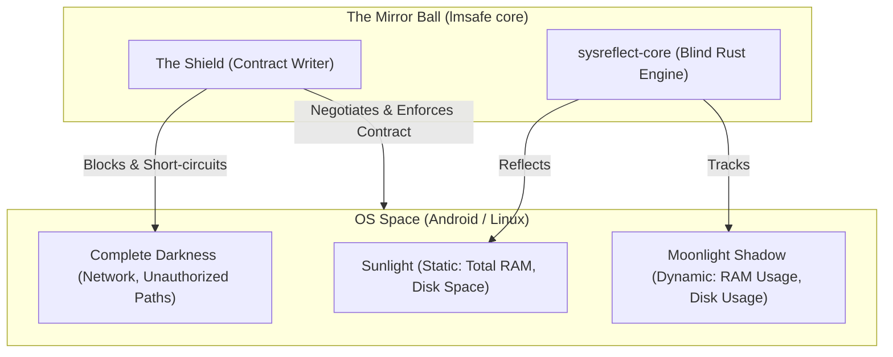
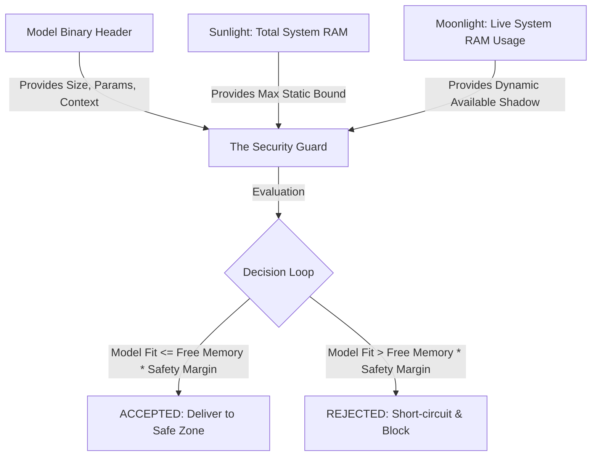
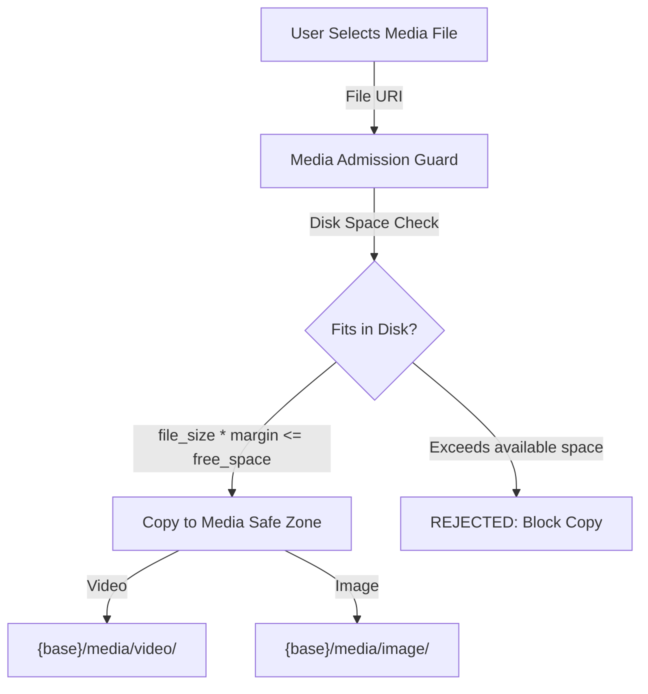

# Local Metaverse Safe (`lmsafe`): The Celestial Safe Zone Contract

`lmsafe` (Local Metaverse Safe) is an architecture designed to host, manage, inspect, and execute Local Models (LMs) within a secure, predictable, and self-disciplined environment. Everything is local — no internet connection required. The Shield reads binary headers directly.

**Who this serves:** any local AI host, through the C FFI — language-agnostic by design, no consumer baked in. The shared vocabulary between Developer and User lives in [GLOSSARY.md](GLOSSARY.md); where this README and the glossary differ, the glossary wins.

---

## 🌌 The Shield Contract

The architecture is governed by a single contract — written by the **Shield** — that defines what the system can see, what it tracks, and what remains in darkness. Everything in lmsafe derives from this contract. One Shield. One contract. Multiple domains (Model, Media).



### 1. The Mirror Ball (كرة المرايا - Earth)
* The core native container. By default, it is blind and silent. It only knows what the **Shield** allows it to see. It never reaches outside itself — no internet, no external APIs. The Shield reads everything it needs from local binary headers directly.

### 2. The Shield (الدرع - The Treaty Writer)
* The negotiator and contract author. It writes a single contract that governs all domains — Model and Media. The contract defines three visibility states: **Sunlight** (always visible), **Moonlight** (tracked in real-time), and **Complete Darkness** (blocked with zero overhead).

### 3. The Sunlight (أشعة الشمس - Static Context)
* Globally visible, immutable specifications (e.g., **Total system RAM**, **Disk Space**, **Model File Size**). These do not change dynamically and are read once.

### 4. The Moonlight & The Shadow (ضوء القمر والظل - Real-time Tracking)
* Real-time dynamic resources. The Moonlight spawns a parallel tracking thread that follows a specific value — the **Shadow** — micro-tick by micro-tick. For models, it tracks **RAM Usage**. For media, it tracks **Disk Usage**.

### 5. The Complete Darkness (الظلمة التامة - Out-of-Scope)
* All OS features outside the contract scope (e.g., Network, unauthorized directory trees). The Shield blocks any requests to these regions with zero system overhead — no CPU cycle wasted looking into the dark.

---

## 🏔️ Contract Enforcement (Sandboxed vs Unsandboxed)

The Shield writes the same contract on every platform, but the enforcement model differs based on whether the OS sandboxes the app:

### Sandboxed: Android & iOS (External Insurance)
Android and iOS enforce the contract through kernel-level restrictions. On Android, the **Storage Access Framework (SAF)** prevents native engines from direct file access. iOS enforces the same — no native engine can process in a directory or use a file directly without the OS fighting back. The Shield negotiates with the OS kernel, and the OS *guarantees* the contract boundaries. Files are **copied** into the SafeZone — the only way to operate safely under external insurance.

### Unsandboxed: macOS & Linux (Self-Imposed Discipline)
On macOS and Linux, there are no OS-level restrictions. The Mirror Ball *could* look anywhere — but it *chooses not to*. The Shield writes the contract and enforces it on itself. There is no external insurance. The contract specifies: Moonlight tracks RAM, Sunlight shows Total RAM, everything else is darkness. Files are **not copied** — the Shield stores the source path as a reference (`_model_path`) and the SafeZone *is* the original location. This is self-imposed discipline.

> *"The contract is not randomly working. It is always working."*

| Platform | Sandbox | SafeZone Behavior |
|----------|---------|-------------------|
| Android | Yes | Copy files into SafeZone |
| iOS | Yes | Copy files into SafeZone |
| macOS | No | Path reference, no copy |
| Linux | No | Path reference, no copy |

---

## 🏔️ The Safe Zone

The **Safe Zone** is a designated, isolated directory partition governed by the Shield contract — organized in **lanes**: a lane fixes what may live there, how it is gated (RAM for models, disk for media), and how it is inspected. Models and media ship today; lanes grow when a project needs one (documents, private storage). The zone is not tied to LLMs. It guarantees that the native engine has direct, unhindered filesystem access — no internet connection required. The Shield reads everything it needs from local binary headers.

### Model Safe Zone

Before any model file enters the Safe Zone, it passes through the **Security Guard** — the Shield's admission checkpoint. The Guard reads the model's binary header directly (no external API, no Hugging Face dependency), compares it against the Sunlight (Total RAM) and Moonlight (Available RAM), and decides:



At the code level: `isSafeToLoad(path, safetyMargin)`.

**Supported Model Families:**

| Family | Format | Inspector |
|--------|--------|-----------|
| `LlamaCpp` | GGUF | Binary header KV parser |
| `WhisperCpp` | GGML | Field-by-field binary reader |
| `LiteRtLm` | TFLite/TFL3 | FlatBuffers + Protobuf reader |
| `Onnx` | ONNX | Directory structure + JSON config |
| `AudioSegmentation` | GGML/ONNX | Filename + directory heuristics |
| `SafeTensors` | SafeTensors | 8-byte header → JSON parse |

> A **model family** is the engine format; a **container** is the file format. One model can ship in several containers — a llama can be GGUF or ONNX, and SafeTensors weights can live inside an ONNX. The Shield reads each container's own metadata (header, graph signature, flatbuffer) — never a filename.

### Media Safe Zone

The Media Safe Zone is **not AI-related** — that is what makes it unique. It is a standalone file store for videos and images, governed by a **disk-space check** rather than RAM-based checks:

```
file_size * safety_margin <= available_disk_space
```

Default safety margin: `1.2` (20% headroom).



**Supported Media Families:**

| Family | Extensions |
|--------|-----------|
| `Video` | mp4, mov, m4v, avi, mkv, webm |
| `Image` | jpg, jpeg, png, webp, gif, heic |

### Safe Zone Directory Layout

```
{base_storage_path}/
  models/       ← Model Safe Zone (per ModelFamily)
    llama-cpp/
    whisper-cpp/
    litert-lm/
    onnx/
    audio-segmentation/
    safetensors/
  media/        ← Media Safe Zone (per MediaFamily)
    video/
    image/
```

### Model vs Media: Key Differences

| Aspect | Model Safe Zone | Media Safe Zone |
|--------|----------------|-----------------|
| Purpose | AI-related (model inference) | Not AI-related (standalone file store) |
| Admission check | RAM-based (`isSafeToLoad`) | Disk-based (`is_storage_safe_for_duplication`) |
| Copy behavior | Platform-dependent (copies on Android, path-reference on Desktop) | Always copies the file |
| Per-file add | No | Yes (`copy_media_to_safe_zone`) |
| Per-file removal | No (only full `clean_safe_zone` wipe) | Yes (`remove_media_from_safe_zone` with path traversal protection) |
| Listing | First model only (`get_first_stored_model`) | Full listing with metadata (`list_media_safe_zone` → `MediaInfo[]`) |

### FFI API

```c
// ── Model Safe Zone ──
char* lmsafe_copy_to_safe_zone(const char* source_path, const char* family_str);
bool lmsafe_clean_safe_zone(const char* family_str);
char* lmsafe_get_first_stored_model(const char* family_str);
char* lmsafe_get_safe_zone_dir(const char* family_str);

// ── Media Safe Zone ──
char* lmsafe_copy_media_to_safe_zone(const char* source_path, const char* media_family, double safety_margin);
char* lmsafe_list_media_safe_zone(const char* media_family);
bool lmsafe_remove_media_from_safe_zone(const char* media_family, const char* file_name);
bool lmsafe_clean_media_safe_zone(const char* media_family);
char* lmsafe_inspect_media_file(const char* path);
```

---

## 📦 Project Structure & Repositories

The repository consists of:

1. **`sysreflect-core` (Rust Library)**: System reflection — the telemetry engine. CPU, memory, network, processes, host info. Compiled as `libsysreflect_core.so`.
2. **`sysreflect-model` (Rust Library)**: Model & media reflection — magic-byte family detection, GGUF/GGML/LiteRT/safetensors parsing, capability inference. All metadata is parsed locally from binary headers — no external APIs.
3. **`lmsafe-zone` (Rust Library)**: The Safe Zone — storage layout for Model and Media Safe Zones, plus the single admission rule (`is this model safe to load?`) that every front-end renders.
4. **`lmsafe-ffi` (Rust FFI Layer)**: A dedicated C FFI wrapper that exposes a C-compatible interface (`lmsafe-ffi/lmsafe.h`) for foreign-language consumers. Compiled as `liblmsafe.so`.
5. **`lmsafe-cli` & `lmsafe-tui` (Rust Tools)**: Command-line utilities for inspecting models and monitoring system resources.

The dependency direction is one-way, with no cycles:

```
sysreflect-core ← sysreflect-model ← lmsafe-zone ← { lmsafe-ffi, lmsafe-cli, lmsafe-tui }
```

Safe Zone logic *depends on* reflection; reflection knows nothing about the Safe Zone.

---

## 🛠️ Implementation Details

### 1. The three engines

`sysreflect-core` is the eyes: it only answers *what is this host doing right now*, using `sysinfo` to track CPU, memory, and network usage (on Apple Silicon it goes through Mach so GPU/Metal pressure counts as used memory).

`sysreflect-model` is the fingerprint reader. Instead of writing duplicate metadata parsers for every platform, it handles it natively in Rust. All metadata is extracted by parsing binary headers and JSON config files directly — zero network calls, zero external service dependencies.

* **Model Inspection**: Parses magic bytes and metadata for Llama (GGUF), Whisper (GGML), LiteRT (TFLite), and Supertonic.
* **Capability Inference**: Automatically determines what a model can do (e.g., `TextGeneration`, `Tools`, `Vision`, `SpeechToText`) based on its architecture and chat templates.

`lmsafe-zone` is the gatekeeper, and it keeps exactly **one** admission rule (`lmsafe_zone::admission`) instead of one copy per front-end:

* **Memory Guard**: Calculates `file_size * safety_margin` against available system RAM to prevent Out-Of-Memory (OOM) crashes before they happen. A zero-byte model is rejected, and unavailable telemetry yields `Unknown` — never a green light.
* **Safe Zone Storage**: Per-family directories, copy-or-reference mode depending on OS sandboxing, media listing and traversal-safe removal.

#### CLI & TUI
* **`lmsafe-cli`**: Inspect any local model file and output its capabilities and metadata (JSON supported).
  ```bash
  cargo run --bin lmsafe-cli -- inspect --file /path/to/Llama-3.2.3.gguf
  ```
* **`lmsafe-tui`**: A terminal UI dashboard for monitoring system CPU, RAM, and top processes.

---

### 2. Consuming via FFI (`lmsafe-ffi`)

Foreign-language consumers call into the native Rust engine through the C API declared in `lmsafe-ffi/lmsafe.h`. The engine returns complex metadata as a JSON string, which the caller decodes into its own domain types (`ModelInspectionReport`, `Capability`, `ModelFamily`, `MediaFamily`).

```mermaid
graph TD
    UI[App UI / User File Picker] -->|Selects Model Path| App[FFI Consumer]
    App -->|C FFI: lmsafe_copy_to_safe_zone| Rust[lmsafe-ffi / sysreflect-core]
    Rust -->|Parses Metadata| Inspector[Model Inspection Report]
    Rust -->|Calculates Safety| Guard[Memory Guard vs Free RAM]
    
    Guard -->|OOM Risk| Reject[Reject Load]
    Guard -->|Safe| Accept[Return Safe File Path]
    
    Accept -->|Passes Path| Engine[Inference Engine (Llama/Whisper)]
```

#### API Interface (C, see `lmsafe-ffi/lmsafe.h`)
```c
// Model Inspection & Safety (JSON via lmsafe_free_string)
char* lmsafe_inspect_model(const char* path);
bool  lmsafe_model_is_safe_to_load(const char* path, double safety_margin);

// Model Safe Zone Storage Orchestration (Powered by Rust)
bool  lmsafe_init_storage(const char* base_path, bool sandboxed);
char* lmsafe_copy_to_safe_zone(const char* source_path, const char* family_str);
bool  lmsafe_clean_safe_zone(const char* family_str);
char* lmsafe_get_first_stored_model(const char* family_str);
char* lmsafe_get_safe_zone_dir(const char* family_str);

// Media Inspection & Safety
char* lmsafe_inspect_media_file(const char* path_str);
char* lmsafe_copy_media_to_safe_zone(const char* source_path_str, const char* media_family_str, double safety_margin);
bool  lmsafe_clean_media_safe_zone(const char* media_family_str);

// Telemetry
float    lmsafe_get_cpu_usage(SystemMonitor* ptr);
uint64_t lmsafe_get_total_memory(SystemMonitor* ptr);
uint64_t lmsafe_get_used_memory(SystemMonitor* ptr);
// ...
```

By delegating the complex binary parsing and storage orchestration to Rust, and passing the results back as JSON to be decoded into caller-side domain models (`ModelInspectionReport`, `Capability`, `ModelFamily`, `MediaFamily`), consumers stay thin while behavior remains consistent across platforms.
