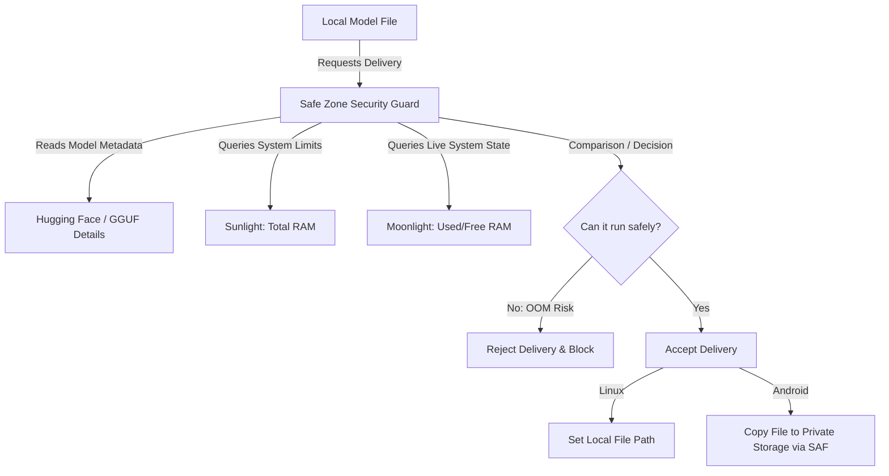

# lmsafe: Local Model Safe Zone & sysreflect

`lmsafe` (Local Model Safe Zone) is an architecture designed to host, manage, and execute Local Models (LMs) within a secure, predictable, and self-disciplined sandbox called the **Mirror Ball**.

The repository consists of:
1. **`lmsafe` Workspace**: The parent orchestration layer handling local models and their safe execution environments.
2. **`sysreflect` (Subsystem)**: The native Rust reflection and telemetry engine that monitors the Safe Zone and OS resource limits.

---

## 🏔️ The Safe Zone Strategy (LM Safe Zone)

The **Safe Zone** is a designated, isolated partition within the **Mirror Ball** where the local model file (.gguf, etc.) resides. It guarantees that nothing stands between the inference engine and the model file.

### 🛡️ The Safe Zone Security Guard (حارس المنطقة الآمنة)
Delivery of a Local Model to the Safe Zone is restricted. The **Safe Zone Security Guard** is the gatekeeper that decides whether to accept or reject a model delivery *before* any files are copied or paths are set.

#### How Validation Works:
1. **Model Metadata (Hugging Face details)**: The Mirror Ball reads the model's specs (model size, parameter size, memory footprint) which are built-in or parsed from the model file header.
2. **Resource Comparison**: The Guard queries **Sunlight** (Total RAM) and **Moonlight** (Available/Free RAM).
3. **The Verdict**: 
   * If the model's RAM requirements exceed what the device can safely allocate, the Guard **rejects** the delivery to prevent an Out-Of-Memory (OOM) crash.
   * If the model can run safely, the Guard **accepts** the delivery.
   * **Linux action**: Sets the direct path to the model.
   * **Android action**: Initiates the file copy to the application's private safe directory (navigating around Storage Access Framework restrictions).

---

## 🌌 The sysreflect Telemetry & Celestial Metaphor

To monitor the Safe Zone's resource footprint (like RAM usage during model loading/inference), we use the `sysreflect` subsystem:

### 1. The Mirror Ball (كرة المرايا - Earth)
* The core native container. By default, it is blind and silent. It only knows what is inside the **Safe Zone** and what the **Shield** allows it to see.

### 2. The Shield (الدرع - The Treaty Writer)
* The negotiator. It handles **Safe Zone Delivery** (like copying GGUF files via SAF on Android) and enforces the boundary rules.

### 3. The Sunlight (أشعة الشمس - Static Context)
* Globally visible, immutable specifications (e.g., **Total system RAM** or **Model File Size**). These do not change dynamically and are read once.

### 4. The Moonlight & The Shadow (ضوء القمر والظل - Real-time Tracking)
* Real-time dynamic resources. When the local model runs, the Moonlight spawns a thread to track the **RAM Usage Shadow** micro-tick by micro-tick.

### 5. The Complete Darkness (الظلمة التامة - Out-of-Scope)
* All OS features outside of the local model and RAM capacity (e.g., Network, unauthorized directory trees). The Shield blocks any requests to these regions with zero system overhead.
